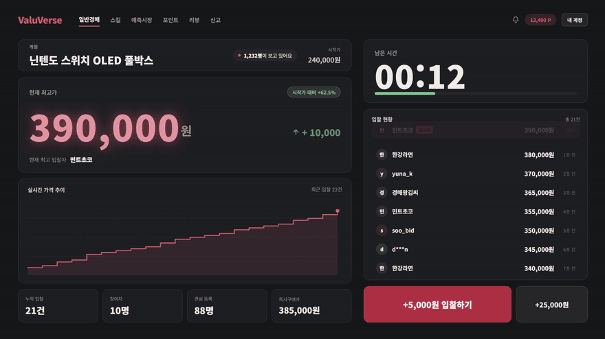
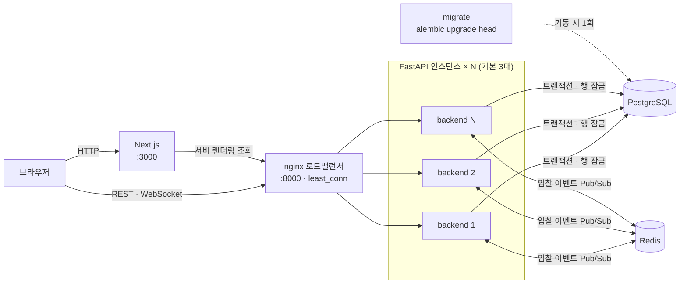
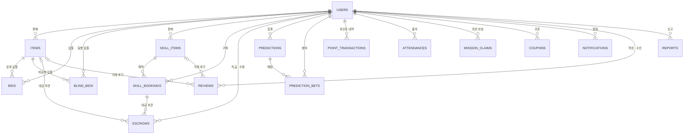

<div align="center">

# ValueVerse

### 블라인드·스킬 경매를 지원하는 실시간 경매 플랫폼

일반 경매에 **블라인드 경매 · 스킬 경매 · 예측시장 미니게임**을 더하고,<br>
**동시 입찰 정합성, 입찰가 보호, 에스크로 정산** 등 거래 신뢰성에 집중한 풀스택 프로젝트

[](https://github.com/yoonjeonggg/valuverse/actions/workflows/ci.yml)


</div>

---

## ▶️ 시연 영상

> 입찰이 실시간으로 쏟아지고, 마감 카운트다운이 끝나면 낙찰이 확정되는 화면입니다.

<div align="center">

<a href="ValueVerse.mp4"></a>

</div>

---

## 프로젝트 소개

기존 경매 플랫폼은 "최고가 낙찰"이라는 단순한 구조에 머물러 있었습니다. ValueVerse는 입찰가를 숨기는
**블라인드 경매**, 시간과 능력을 거래하는 **스킬 경매**로 거래 방식을 넓히고, 무상 포인트 기반
**예측시장 미니게임**으로 매일 접속할 이유를 만들고자 기획했습니다.

경매는 금액이 오가는 서비스이기 때문에 기능의 개수보다 **거래의 신뢰성**을 우선했습니다. 동시에 입찰이
몰려도 최고가가 틀어지지 않고, 마감 전에는 입찰가가 어떤 경로로도 새어나가지 않으며, 포인트가 중간에
사라지거나 두 번 쓰이지 않도록 설계했습니다.

---

## 1. 개발 기간 및 작업 관리

### 개발 기간

- **2026.08.24 ~ 진행 중**

### 작업 관리

- **GitHub**: 소스 코드 관리, GitHub Actions 기반 CI
- **Notion**: 기획서, 요구사항 명세서, 개발명세서 관리

## 2. 개발 환경

- **Backend**: Python 3.13, FastAPI 0.115, SQLAlchemy 2.0, Alembic
- **Frontend**: Node.js 22, Next.js 16, React 19, TypeScript
- **Database**: PostgreSQL 16, Redis 7 (로컬 단독 실행 시 SQLite 사용 가능)
- **Infra**: Docker Compose, nginx 1.28
- **Test · Lint**: pytest, ruff, ESLint

## 3. 기술 스택

### 기술 선정 이유

#### FastAPI

실시간 입찰용 WebSocket과 REST API를 하나의 앱에서 다룰 수 있고, Pydantic 스키마가 곧 요청 검증과
응답 형태가 됩니다. 블라인드 입찰처럼 **응답에 어떤 필드를 내보낼지가 보안과 직결되는 기능**을 스키마
단위로 통제할 수 있어 선택했습니다.

#### PostgreSQL

입찰, 에스크로, 정산은 트랜잭션 안에서 함께 성공하거나 함께 실패해야 합니다. 동시 입찰을 순차 처리할
**행 단위 잠금(`SELECT ... FOR UPDATE`)** 이 필요했기 때문에, 트랜잭션과 잠금이 검증된 관계형 DB를
선택했습니다.

#### Redis Pub/Sub

백엔드를 여러 대로 늘리면 WebSocket 연결이 인스턴스마다 흩어집니다. 입찰 이벤트를 Redis 채널로 발행하면
모든 인스턴스가 자신에게 붙은 클라이언트에 전달할 수 있어, **sticky session 없이도 수평 확장**이 가능합니다.

#### Next.js · TypeScript

공개 화면은 서버 컴포넌트로 첫 데이터를 HTML에 담아 **초기 로딩 대기와 레이아웃 밀림을 줄이고**,
입찰처럼 상호작용이 많은 화면은 클라이언트 컴포넌트로 분리했습니다. API 응답은 공용 타입으로 정의했습니다.

#### Docker Compose · nginx

DB, Redis, 로드밸런서, 백엔드 다중 인스턴스, 프론트엔드를 **명령 한 번으로 동일하게 재현**하기 위해
선택했습니다. nginx는 연결이 오래 유지되는 WebSocket이 고르게 퍼지도록 `least_conn`으로 분산합니다.

### 기술 스택 상세

| 구분 | 기술 |
|---|---|
| **Backend** | FastAPI, Uvicorn, SQLAlchemy 2.0, Alembic, Pydantic v2 |
| **Auth** | JWT (python-jose), bcrypt (passlib) |
| **Frontend** | Next.js (App Router), React, TypeScript, Tailwind CSS |
| **Database** | PostgreSQL |
| **Realtime** | WebSocket, Redis Pub/Sub |
| **Infra** | Docker Compose, nginx |
| **CI** | GitHub Actions |
| **Test · Lint** | pytest, ruff, ESLint |

## 4. ☁️ 서비스 아키텍처



- **분산**: `least_conn`으로 연결 수가 가장 적은 인스턴스에 전달합니다.
- **장애 대응**: 연결 실패 시 다른 인스턴스로 재시도하고, 연속 3회 실패한 인스턴스는 10초간 제외합니다.
  POST 같은 비멱등 요청은 재시도하지 않아 입찰이 두 번 처리되지 않습니다.
- **스케일링**: nginx가 Docker DNS를 10초마다 다시 조회해 인스턴스 증감을 재시작 없이 반영합니다.
- **마이그레이션**: `migrate` 서비스가 한 번만 실행하고, 끝난 뒤에 백엔드가 뜹니다.
- **추적**: 요청 ID(`X-Request-ID`)가 nginx 로그와 백엔드 로그에 같은 값으로 남습니다.

## 5. 🗄 ERD

총 16개 테이블로 구성됩니다. 주요 관계는 아래와 같습니다.



> 블라인드 입찰가는 `bids`와 분리된 `blind_bids` 테이블에 저장합니다. 스키마는 Alembic으로 관리합니다.

## 6. 📁 프로젝트 구조

```text
valuverse
├── backend
│   ├── app
│   │   ├── core            # 설정, 인증, 의존성, 예외, 로깅, DB 헬퍼
│   │   ├── models          # SQLAlchemy 모델
│   │   ├── schemas         # Pydantic 요청/응답 스키마
│   │   ├── routers         # REST · WebSocket 엔드포인트
│   │   ├── services        # 비즈니스 로직, WS 브로드캐스트
│   │   ├── database.py     # 엔진 / 세션
│   │   └── main.py         # 앱 엔트리포인트
│   ├── alembic             # DB 마이그레이션
│   └── tests               # pytest (인메모리 SQLite)
├── frontend
│   └── app
│       ├── lib             # API 래퍼, 공용 타입, UI 컴포넌트, 챗봇 위젯
│       ├── items           # 일반 · 블라인드 경매
│       ├── skill-items     # 스킬 경매, 예약
│       ├── predictions     # 예측시장
│       ├── points          # 포인트 센터
│       ├── me              # 마이페이지
│       ├── notifications   # 알림
│       ├── reviews         # 리뷰
│       ├── reports         # 신고
│       ├── admin           # 관리자 대시보드
│       └── auth            # 로그인 / 회원가입
├── nginx                   # 로드밸런서 설정
├── docs/assets             # README 이미지
├── docker-compose.yml      # 전체 스택 실행
└── ValueVerse.mp4          # 시연 영상
```

## 7. 주요 기능

### 실시간 경매 `#WebSocket` `#동시성 제어`

- WebSocket 기반 실시간 입찰, 접속 시 현재 상태 스냅샷 수신, 입찰 · 마감 이벤트 방 전체 브로드캐스트
- 마감 3분 이내 입찰 시 3분 **자동 연장**(최대 10회, 환경 변수로 조정)으로 스나이핑 방지
- `SELECT ... FOR UPDATE` 행 잠금으로 **동시 입찰 정합성 보장**
- 낙찰 확정, 즉시구매, 판매자 조기 마감 지원

### 블라인드 경매 `#Sealed-bid`

- 마감 전 금액 비공개, **내 순위만 노출**
- **1st-price / Vickrey(2nd-price)** 낙찰 방식 선택 지원
- 마감 후에만 전체 결과 공개

### 스킬 경매 · 에스크로 `#에스크로`

- 시간과 능력을 거래하는 스킬 상품 등록과 예약
- 판매자 예약 요청 → **구매자 수락 시 포인트를 에스크로에 보관**
- 완료 시 판매자 정산, 노쇼 시 귀책에 따라 정산 또는 환불, 취소 시 환불

### 예측시장 · 포인트 이코노미 `#파리뮤추얼`

- Yes/No 풀 비율 기반 **실시간 배당률 계산**과 비례 정산, 승리 포지션 풀이 비면 전원 원금 환불
- 출석 · 미션 · 광고로 적립, 상단 노출권 · 수수료 할인쿠폰으로 소모

### AI 보조 `#서비스 분리`

- 과거 낙찰가 통계 기반 **시세 · 시작가 추천**, 어뷰징 문구 탐지
- 상품 설명 초안 생성과 보완 제안, 스킬 소개글 기반 카테고리 · 난이도 태깅
- 답변 근거를 함께 반환하는 **입찰 상담 챗봇**
- 경매 로직이 AI 서비스에 의존하지 않도록 분리해 AI 장애가 경매에 영향을 주지 않는 구조
- 현재는 LLM 없이 통계와 규칙 기반으로 동작하며, LLM Gateway는 별도 서비스로 분리할 예정

### 커뮤니티 · 운영

- 입찰 경쟁, 낙찰, 정산, 신고 처리 이벤트 **알림**
- 완료된 거래의 당사자만 작성할 수 있는 **리뷰**
- 신고 인용 시 대상 제재(상품 · 리뷰 삭제, 누적 신고 계정 비활성화)
- 활동을 모아 보는 **마이페이지**, 운영을 위한 **관리자 대시보드**

### 프론트엔드 `#Next.js`

- 홈, 경매 · 스킬 · 예측시장 목록과 상세, 포인트 센터, 마이페이지, 관리자 대시보드 등 전 화면 구현
- 공개 화면 서버 렌더링, 조회 실패 · 빈 목록 · 로딩 상태를 구분해 표시
- 공용 컴포넌트와 디자인 토큰으로 전 화면 톤 통일, 라이트 / 다크 모드 지원

## 8. 🚀 기술적 성과

### 테스트

- 백엔드 테스트 **298개 전체 통과**, 라인 커버리지 **100%** (`app/` 기준 2,368 라인)
- 권한 403/404, 상태 충돌 409, 입력 검증 400/422 등 예외 경로와 WebSocket 오류, Redis 재연결까지 검증

### 확장성

- 백엔드를 **기본 3대로 수평 확장**, 명령 한 번으로 증감 가능
- Redis Pub/Sub으로 **인스턴스가 달라도 같은 경매의 입찰 이벤트를 수신**

### 자동화

- push · PR마다 ruff, pytest, ESLint, Next.js 빌드, Docker 이미지 빌드를 **CI로 자동 검증**
- 테스트에서 마이그레이션과 모델의 동기화 여부까지 확인

### 관측 가능성

- 모든 로그에 요청 ID를 부여하고, 500 응답 본문에도 포함해 **사용자 문의에서 로그까지 바로 추적**
- 포인트 변동, 경매 마감, 정산 등 주요 이벤트 기록

## 9. 💥 트러블 슈팅

<details>
<summary><b>1. 동시 입찰 데이터 정합성 문제</b></summary>

- **문제 상황**: 같은 상품에 입찰이 동시에 몰리면 낮은 금액이 최고가로 덮어써질 위험
- **해결 과정**: `SELECT ... FOR UPDATE` 락으로 입찰을 순차 처리하고, 검증부터 갱신까지를 하나의 트랜잭션으로 묶음
- **배운 점**: 실시간 서비스는 기능보다 동시성 정합성을 먼저 설계해야 함을 체감

</details>

<details>
<summary><b>2. 블라인드 경매 입찰가 노출 문제</b></summary>

- **문제 상황**: 화면에서 숨겨도 API 응답에 금액이 포함되면 우회 조회 가능
- **해결 과정**: 입찰가를 별도 테이블로 분리하고, 마감 전 응답에서 금액 제외
- **배운 점**: 데이터 보호는 화면이 아닌 서버 응답 단계에서 차단해야 함을 이해

</details>

<details>
<summary><b>3. 포인트 이중 사용 문제</b></summary>

- **문제 상황**: 잔액을 확인한 뒤 차감하는 사이에 동시 요청이 끼어들면 같은 포인트를 두 번 사용할 수 있고, 동시 적립에서는 갱신이 유실될 수 있음
- **해결 과정**: 포인트 변경 시 사용자 행을 잠가 잔액 확인과 차감을 한 트랜잭션에서 처리
- **배운 점**: 입찰뿐 아니라 잔액을 다루는 모든 경로가 같은 동시성 문제를 가진다는 점을 확인

</details>

<details>
<summary><b>4. 다중 인스턴스 WebSocket 브로드캐스트 문제</b></summary>

- **문제 상황**: 백엔드를 여러 대로 늘리면 WS 연결이 흩어져, 다른 인스턴스에 붙은 사용자에게 입찰 이벤트가 전달되지 않음
- **해결 과정**: 입찰 이벤트를 Redis 채널로 발행하고, 모든 인스턴스가 구독해 자신의 연결에 전달
- **배운 점**: 메모리에 상태를 두는 구조는 확장 시점에 깨지므로, 인스턴스 간 공유 경로를 설계해야 함을 이해

</details>

<details>
<summary><b>5. Docker Compose 환경변수 · 포트 충돌 문제</b></summary>

- **문제 상황**: 컨테이너 기동 시 DB 연결 실패와 포트 충돌 반복 발생
- **해결 과정**: `.env` 접속 정보 통일 및 `DB_PORT` 재지정, CI에 compose 설정 검증 추가
- **배운 점**: 초기 개발 환경 세팅이 이후 개발 속도를 좌우함을 체감

</details>

## 10. 🌱 프로젝트를 통해 배운 것들

#### 동시성은 기능이 아니라 설계의 문제

단건 테스트에서는 문제없던 입찰 로직이 동시 요청에서는 깨질 수 있음을 인지하고, **비관적 락으로
검증부터 갱신까지를 하나의 임계 구역으로 묶는 설계**를 체득했습니다.

#### 돈이 오가는 로직은 트랜잭션 경계부터 정한다

입찰, 에스크로 보관, 배당 정산처럼 금액이 움직이는 로직은 **차감과 보관, 정산과 지급이 반드시 함께
성공하거나 함께 실패**하도록 트랜잭션 범위를 먼저 정의하는 습관을 길렀습니다.

#### 정합성과 성능 사이의 트레이드오프

락은 정합성을 보장하지만 대기 시간을 늘립니다. **락 범위를 상품 단위로 최소화**하며 정합성과 응답 속도
사이의 균형을 고민하는 경험을 쌓았습니다.

## 11. API 엔드포인트

- **Swagger UI**: `http://localhost:8000/docs`
- **규모**: REST 80개 + WebSocket 1개
- 정책과 환경 변수는 [`backend/README.md`](backend/README.md)를 참고하세요.

| 카테고리 | 주요 엔드포인트 |
|---|---|
| **인증 · 회원** | `POST /auth/signup` `POST /auth/login` `GET /users/me` `GET /users/me/dashboard` |
| **경매** | `POST /items` `GET /items` `GET /items/{id}` `POST /items/{id}/close` `POST /items/{id}/buy-now` `POST /items/{id}/spotlight` |
| **입찰** | `POST /items/{id}/bids` `GET /items/{id}/bids` `DELETE /bids/{id}` `WS /items/{id}/bid` |
| **블라인드 입찰** | `POST /items/{id}/blind-bids` `GET /items/{id}/blind-bids/my-rank` `GET /items/{id}/blind-bids/results` |
| **스킬 · 에스크로** | `POST /skill-items` `POST /skill-bookings` `POST /skill-bookings/{id}/accept` `POST /skill-bookings/{id}/complete` `POST /skill-bookings/{id}/no-show` `GET /escrows/{id}` |
| **예측시장** | `GET /predictions` `GET /predictions/{id}/odds` `POST /predictions/{id}/bets` `POST /predictions/{id}/settle` |
| **포인트** | `GET /users/me/points/balance` `POST /points/check-in` `POST /points/missions/{key}/claim` `POST /points/ad-reward` `POST /points/coupons/{key}/redeem` |
| **AI 보조** | `GET /ai/price-suggestion` `POST /ai/abuse-check` `POST /ai/description-suggestion` `POST /ai/skill-tag-suggestion` `POST /ai/chat` |
| **알림 · 리뷰 · 신고** | `GET /users/me/notifications` `POST /notifications/read-all` `POST /reviews` `POST /reports` `PATCH /reports/{id}` |

## 12. 🚀 Getting Started

### Docker로 전체 실행 (권장)

PostgreSQL, Redis, nginx, 백엔드 3대, 프론트엔드를 한 번에 띄웁니다.

```bash
git clone https://github.com/yoonjeonggg/valuverse.git
cd valuverse

docker compose up --build          # 화면 http://localhost:3000 , API http://localhost:8000
docker compose down -v             # 정리 (DB 볼륨 포함)
```

```bash
BACKEND_REPLICAS=5 docker compose up -d          # 처음부터 5대로 실행
docker compose up -d --scale backend=5 backend   # 실행 중에 인스턴스 수 변경
```

- 호스트 포트가 충돌하면 `DB_PORT` / `BACKEND_PORT` / `FRONTEND_PORT`로 재지정합니다. (예: `DB_PORT=55432 docker compose up`)
- `SECRET_KEY`는 환경 변수로 주입합니다. 미지정 시 개발용 기본값이 쓰이므로 운영에서는 반드시 지정하세요.

### 로컬 실행

Python 3.13, Node.js 22 기준입니다. (Python 3.14는 `psycopg-binary` 설치가 되지 않습니다.)

```bash
# 백엔드
cd backend
python -m venv venv
venv\Scripts\activate              # macOS / Linux: source venv/bin/activate
pip install -r requirements.txt
cp .env.example .env
uvicorn app.main:app --reload      # http://localhost:8000

# 프론트엔드 (새 터미널)
cd frontend
npm install
cp .env.local.example .env.local
npm run dev                        # http://localhost:3000
```

### 테스트

```bash
cd backend
pytest
```

### 개발 문서

- [`backend/README.md`](backend/README.md): 환경 변수, 코드 규칙, 정산 정책, 로깅, 테스트
- [`frontend/README.md`](frontend/README.md): 구조, 화면 작성 규칙, 디자인 토큰, 인증

---

<div align="center">

**ValueVerse** · 개인 프로젝트 · 2026

</div>
